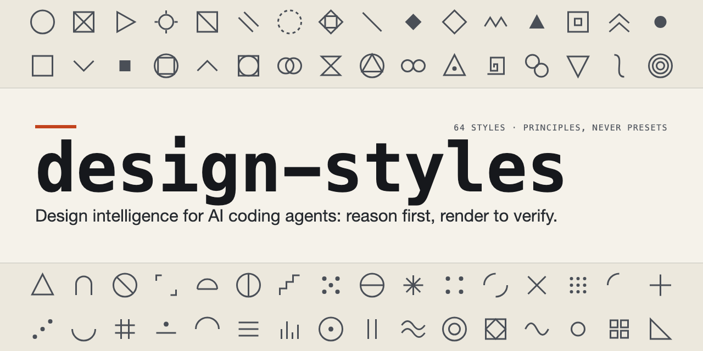
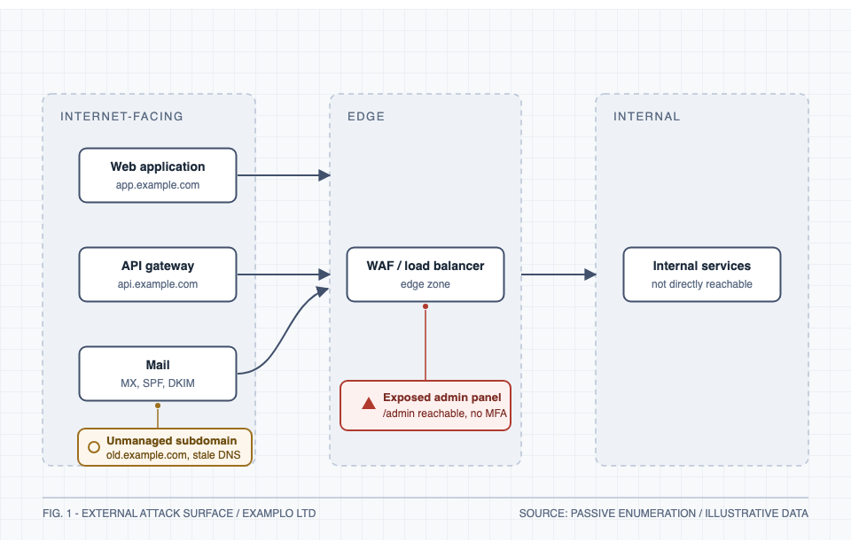

# design-styles



A design intelligence skill for AI coding agents (Claude Code and compatible SKILL.md hosts): it makes the agent reason about design problems before styling them, transfer principles across disciplines, verify its visual output by actually rendering it, and report honestly what was and was not checked.

## The problem it addresses

Ask a coding agent for a dashboard and you usually get a competent page styled by habit: the trend chart on top because dashboards have charts on top, severity in colour alone, a default state with an empty panel. Design skills that only hand the agent a look do not fix this; a published review of the category notes they "cannot see their own output". design-styles attacks both halves: a problem-first decision engine chooses the direction for reasons it can state, and a mandatory verification loop renders the result, inspects it, and fixes what the render exposes.

In a blind-judged comparison on this exact failure mode (a SOC triage dashboard), the skill-guided run made the alert queue the primary region with pre-populated context and SLA/staleness signals, and beat the baseline 87.5 to 75.0 (see Evaluation below).

## What it looks like

Genuine outputs of the skill's verification loop (source SVGs in `examples/svg/`, build record in `examples/svg/README.md`):




More real outputs, with their prompts and decision records: `docs/gallery.md`.

## Install

```bash
# personal (all projects)
cp -r design-styles ~/.claude/skills/design-styles

# or project-scoped
cp -r design-styles .claude/skills/design-styles
```

Tested on Claude Code 2.1.x on macOS. Other SKILL.md-compatible agents should load the entrypoint, but only Claude Code is verified; `disable-model-invocation` is a Claude Code field (remove it for hosts that reject unknown frontmatter).

## Invoke

```
/design-styles design a threat-intel dashboard for SOC analysts
/design-styles critique this landing page and separate defects from taste
/design-styles build an SVG architecture diagram, render and verify it
/design-styles compare Art Deco vs Swiss Design for an annual report cover and pick one
```

A realistic result, from the evaluation runs: for "recommend a style for a regulated private bank's wealth dashboard", the skill chose Corporate Swiss with one scoped Luxury Editorial influence, rejected Glassmorphism (backdrop-dependent contrast vs compliance-grade AA on every figure), Dark Luxury (hostile to dense data) and Aerospace Instrumentation's costume while transferring its semantic colour-reservation principle, and specified tabular numerals, density tiers and token-level AA pairs. Full file: `evaluation/runs/treatment/task-8/recommendation.md`.

## Activation modes

Ships in **opt-in mode** (`disable-model-invocation: true`): it never activates just because a task involves design, UI or SVG; only explicit invocation runs it. Prefer automatic pickup on design tasks? Switch modes with one command (and back):

```bash
python3 tools/set-activation.py auto      # Claude may invoke it on matching design tasks
python3 tools/set-activation.py opt-in    # back to explicit /design-styles only
python3 tools/set-activation.py status    # show the current mode
```

The auto variant also ships as a plain copy at `variants/SKILL-v1-auto.md`; copying it over `SKILL.md` is equivalent to running the script.

## What is inside

- **A problem-first decision engine**: audience, constraints and quality criteria before any colour or font; one primary direction with named, justified exclusions.
- **A 64-style catalogue** (`references/styles/`): every style from Minimalism to Aerospace Instrumentation with philosophy, characteristics, when NOT to use it, common mistakes, accessibility notes, conflicts and transferable principles. Styles are sources of principles, never presets.
- **Cross-disciplinary principle transfer**: aerospace instrument hierarchy into dashboards, architectural rhythm into editorial layouts, horological finishing into icon systems, with an explicit rule separating principle transfer from aesthetic borrowing, and a rule against forcing influences into simple tasks.
- **Design-system composition**: before styling anything it looks for an existing design system (an installed brand skill, project tokens, brand guidelines) and works inside it; where none exists it can create one, including as a reusable design-system SKILL.md package other sessions can load.
- **SVG engineering with a mandatory verification loop**: validate, render headlessly, inspect at target and small sizes on light and dark, fix, re-render, and state what remains unverified.
- **Critique and evaluation rubrics** that order findings by consequence and separate confirmed defects from taste.
- **12 modes** inferred from natural language: DESIGN, CRITIQUE, STYLE, EVOLVE, SYSTEM, RESEARCH, PRODUCT, INTERFACE, ART DIRECTION, AUDIT, INVENT, DECIDE.
- **The design loop with dynamic depth**: every deliverable cycles make, render, critique, refine; depth scales from Sketch (one pass) through Studio (full loop) to Flagship (crew + parallel exploration), declared up front so you can override it (`workflows/design-loop.md`).
- **Parallel exploration**: for direction-defining work, 2-4 genuinely different directions developed in parallel as real rendered comps, judged on evidence, collapsed to one (`workflows/parallel-exploration.md`).
- **A named crew** (`agents/`): eight installable specialist agents, one Claude per station with a shared help-the-user mindset: SCOUT (brief), RELIC (references), MUSE (direction), FORGE (build), ROAST (critique), RAMP (accessibility), PIXEL (verification), PENNY (business). Solo is the default; the crew is for flagship work. `cp agents/*.md ~/.claude/agents/` makes them spawnable.
- **A lessons ledger** (`LESSONS.md`): confirmed mistakes become recorded rules that future sessions load, and rules that generalise get promoted into the references. The first entries are this skill's own evaluated failures, including the one that lost a blind comparison and the fix that won the rerun.

The skill's point of view is a studio-trained designer with doctoral research discipline who runs a design-first company: craft sets the bar, evidence keeps it honest, founder judgement makes it ship. SpaceX, Apple, Braun, Rolex and Adobe serve as standards to meet, never templates to copy.

### Limitations

- Measured on Claude-family agents only; one run per condition per task in the evaluation (see below).
- Rendering verification needs a local Chromium; without one the skill inspects source and says rendering is unverified.
- Live activation-boundary trials and screen-reader testing are not yet in the recorded test log (`tests/behavioural-tests.md` tracks exactly what ran).
- History entries mark interpretation and approximate dates rather than claiming precision; fast-moving platform facts carry verify-current notes.

## Measured evaluation (not a promise)

A pre-registered, blind-judged comparison (8 tasks, control vs skill-enabled, same model and tools, judges rendered everything they scored) found the skill-guided run better in 7 of 8 tasks, mean +5.8/100 (+7.1 after one targeted fix and a verified rerun), at about +22% token cost. A follow-up n=3 replication on three representative tasks went 9 of 9 to the skill (two-sided sign test p of roughly 0.004), mean +8.5: diagrams +12.5, dashboards +9.7, advisory text +3.3. That still sits under the +10 overall threshold the protocol fixed in advance, so the recorded verdict is **Partially effective**, with replication confirming the direction and locating the strong effect in complex artefact work. Full methodology, raw scores, artefacts, failures and fixes: [EVALUATION.md](EVALUATION.md) and `evaluation/`.

## Verify it yourself

```bash
python3 -I tests/validate_skill.py
```

Checks the entrypoint contract, every cross-file link, SVG integrity of the examples, 64-entry catalogue coverage and activation-mode consistency. Behavioural scenarios and their honest run log: `tests/behavioural-tests.md`. Ecosystem positioning research with dated sources: `docs/ecosystem-notes.md`.

## Repository layout

```
SKILL.md                      entrypoint: identity, decision engine, principles, reference map
references/                   15 modules + styles/ (64-style catalogue in 6 category files)
workflows/                    10 procedures (design, critique, SVG, audits, design systems...)
examples/                     3 annotated cases + 6 verified SVGs incl. critique before/after
evaluation/                   pre-registered protocol, fixtures, all run artefacts, judge scores
tests/                        structure validator + behavioural scenarios with run log
agents/                       the crew: 8 installable specialist agent personas
LESSONS.md                    append-only ledger of confirmed mistakes and their rules
tools/set-activation.py       switch opt-in <-> auto activation
variants/SKILL-v1-auto.md     the auto-activation copy (v1)
docs/                         gallery, ecosystem notes, preview assets
EVALUATION.md                 results and verdict of the controlled comparison
```

## Contributing and licence

Contributions welcome: styles with sources, SVG cases, evaluation tasks, compatibility fixes. See [CONTRIBUTING.md](CONTRIBUTING.md); keep `tests/validate_skill.py` green. Security policy: [SECURITY.md](SECURITY.md). Changes: [CHANGELOG.md](CHANGELOG.md). Licence: [MIT](LICENSE).
